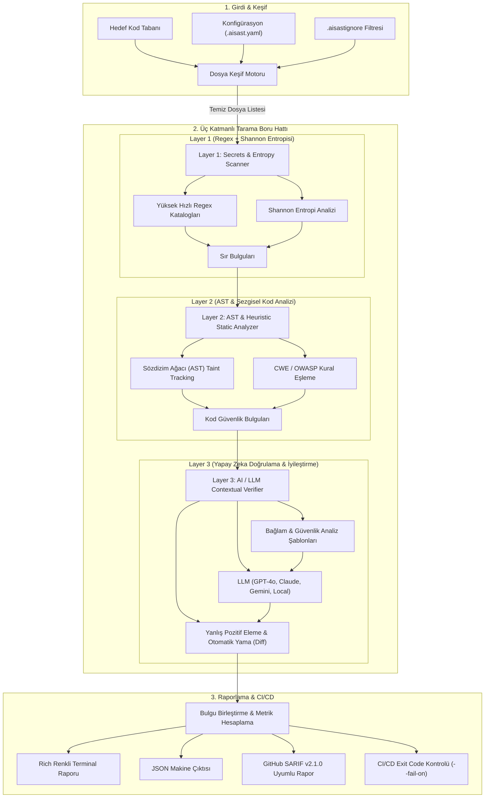
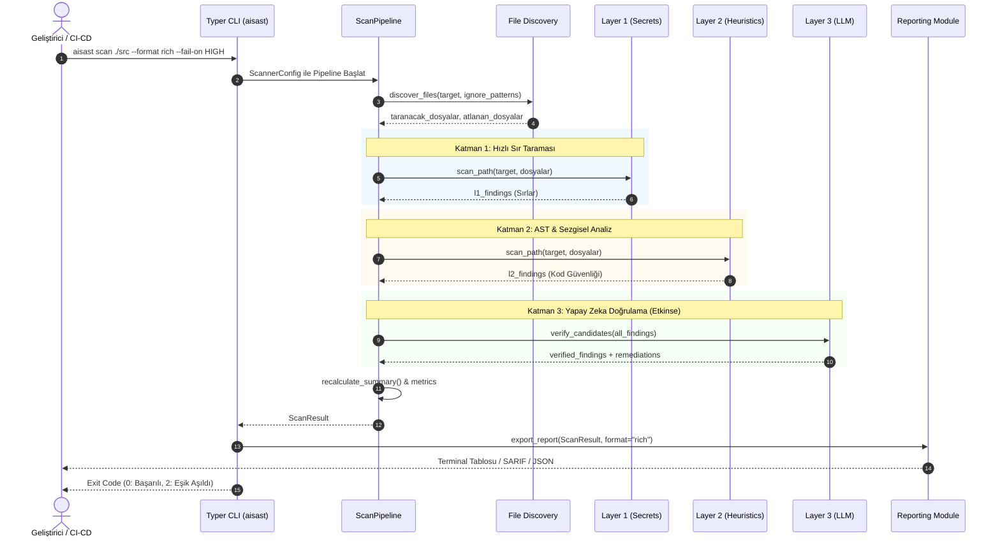
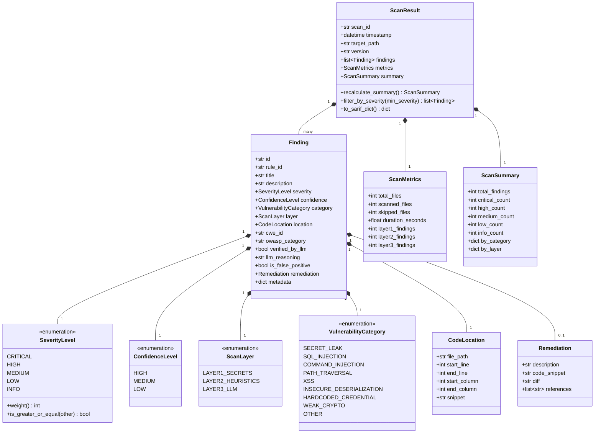

# AI-SAST (`aisast`) Mimari ve Tasarım Dokümantasyonu

**Proje:** AI Destekli Kod Güvenliği & Sır Tarayıcı CLI (`aisast`)  
**Yazar & Geliştirici:** Yiğit Ali Çolakoğlu  
**Durum:** Kararlı Sürüm (v0.1.0 - Production Ready)  

> [!NOTE]
> Detaylı dosya keşfi, ignore motoru ve Git diff hunk mimarisi için bkz: [docs/SCANNER_ENGINE.md](file:///c:/Users/yigit/Desktop/Yazılım%20Proje%20Denemeleri/AI%20Destekli%20Kod%20Güvenliği/docs/SCANNER_ENGINE.md).  
> Detaylı Layer 1 sır ve entropi avcısı mimarisi için bkz: [docs/LAYER1_SECRETS.md](file:///c:/Users/yigit/Desktop/Yazılım%20Proje%20Denemeleri/AI%20Destekli%20Kod%20Güvenliği/docs/LAYER1_SECRETS.md).  
> Detaylı Layer 2 AST ve sezgisel analiz mimarisi için bkz: [docs/LAYER2_HEURISTICS.md](file:///c:/Users/yigit/Desktop/Yazılım%20Proje%20Denemeleri/AI%20Destekli%20Kod%20Güvenliği/docs/LAYER2_HEURISTICS.md).  
> Detaylı Layer 3 AI doğrulama ve patch mimarisi için bkz: [docs/LAYER3_AI_ENGINE.md](file:///c:/Users/yigit/Desktop/Yazılım%20Proje%20Denemeleri/AI%20Destekli%20Kod%20Güvenliği/docs/LAYER3_AI_ENGINE.md).  
> Detaylı dağıtım, Pre-Commit ve CI/CD GitHub Actions rehberi için bkz: [docs/DEPLOYMENT_AND_CICD.md](file:///c:/Users/yigit/Desktop/Yazılım%20Proje%20Denemeleri/AI%20Destekli%20Kod%20Güvenliği/docs/DEPLOYMENT_AND_CICD.md).

---

## 1. Giriş ve Tasarım Felsefesi

Geleneksel Statik Kod Analizi (SAST) araçları ya kural tabanlı katı yaklaşım sergileyerek aşırı miktarda **yanlış pozitif (False Positive)** üretir ya da modern web ve bulut mimarilerindeki karmaşık zafiyetleri gözden kaçırır. Sır tarayıcılar ise çoğunlukla sadece basit regex eşleşmelerine dayanır ve yüksek entropili test verilerini gerçek sırlardan ayırt edemez.

`aisast`, bu sorunu çözmek için **3 Katmanlı Hibrit Filtreleme Hunisi (Tri-Layer Hybrid Funnel)** mimarisiyle tasarlanmıştır:
1. **Hız ve Düşük Maliyet Önceliği:** Kaynak tüketimi düşük olan deterministik katmanlar en önde çalışır.
2. **Derinlik ve Doğruluk:** Karmaşık ve maliyetli yapay zeka analizleri sadece şüpheli aday havuzuna uygulanır.
3. **Standartlara Uyum:** Çıktılar endüstri standardı olan **SARIF v2.1.0** (GitHub Code Scanning uyumlu), JSON ve Rich CLI formatlarında sunulur.

---

## 2. 3 Katmanlı Mimari Huni Modeli

---

## 3. Katmanların Sorumluluk Matrisi

| Katman | Sorumluluk | Teknoloji / Yaklaşım | Hedef Zafiyetler | Hız / Maliyet |
|---|---|---|---|---|
| **Layer 1: Secrets & Entropy** | Kaynak koddaki sırlar, anahtarlar ve tokenların tespiti | Regex Katalogları, Shannon Entropisi, Base64/Hex çözücüler | AWS Keys, JWT, GitHub Token, Private Keys, DB Parolaları | Çok Yüksek Hız (~10k satır/sn), Sıfır API Maliyeti |
| **Layer 2: AST & Heuristics** | Kod sözdizimi, veri akışı ve tehlikeli fonksiyon çağrıları | Python AST / Tree-sitter, Desen Eşleme | SQLi, Command Injection, Path Traversal, eval/exec, Insecure Deserialization | Yüksek Hız, Deterministik, Sıfır API Maliyeti |
| **Layer 3: AI / LLM Verifier** | Şüpheli bulguların bağlamsal analizi, yanlış pozitif eleme | LLM API (OpenAI, Anthropic, Gemini, Ollama/Local), Yapılandırılmış Çıktı | Karmaşık İş Mantığı Hataları, Bağlamsal Doğrulama, Otomatik Diff Üretimi | Kontrollü Hız, Yüksek Hassasiyet, Düşük Token Harcaması (Sadece Adaylar) |

---

## 4. Veri Akışı ve Yürütme Sıralaması (Sequence Diagram)

---

## 5. Çekirdek Veri Modelleri (Class Diagram)

Tüm katmanlar ve raporlama modülleri, tip güvenliğini ve serileştirme standardını sağlamak amacıyla **Pydantic v2** tabanlı modelleri kullanır:

---

## 6. Güvenlik ve İzolasyon Standartları

- **Zero-Telemetry:** Tarama sonuçları, kod parçacıkları ve metrikler kullanıcının izni olmadan üçüncü taraf sunuculara iletilmez.
- **Güvenli Token Yönetimi:** Layer 3 LLM anahtarları ve sırları doğrudan `.env` veya işletim sistemi ortam değişkenlerinden okunur; asla kod içine gömülmez veya rapora yazılmaz.
- **İhmal Listesi Bütünlüğü:** `.aisastignore` dosyası, `.git/`, sanal ortamlar, binary ve paket lock dosyalarını otomatik olarak hariç tutarak yanlış pozitif fırtınasını önler.

---

## 7. Geliştirme Yol Haritası (Roadmap)

- [x] **FAZ 0:** Proje İskeleti, Pydantic v2 Veri Modelleri, Typer CLI, Raporlama Arayüzü ve Mimari Dokümantasyon.
- [x] **FAZ 1:** **Git & Dosya Tarama Motoru**:
  - Unified Diff Hunk Ayrıştırıcı (`git diff --staged -U0`).
  - Dinamik Ignore Motoru (`.gitignore` & `.aisastignore`).
  - İçerik Bazlı Binary Tespiti (Null-Byte `\x00` kontrolü).
  - Kapsam Farkındalığı (`ScannableFile.is_line_in_scope`).
- [x] **FAZ 2:** **Layer 1 Sır & Entropi Avcısı ve Maskeleme Motoru**:
  - Gelişmiş Regex desen katalogları (12+ kural: AWS, OpenAI, Anthropic, Gemini, GitHub, Stripe, Slack, Private Keys, JWT, DB URI, Generic Password).
  - Matematiksel Shannon Entropi hesaplayıcısı ($H(X)$) ve `SEC_ENTROPY_01` anomali tespiti.
  - Gizlilik maskeleme (`mask_secret`, `redact_line_snippet`) ve LLM gizlilik kalkanı (`redact_secrets_in_text`).
  - False-positive eleme mekanizması (`is_likely_false_positive_secret`).
  - Satır içi ihmal (`# aisast: ignore`, `# nosec`) ve `--staged` kapsam denetimi.
  - Özel kural yükleyici (`custom_rules_path` YAML desteği).
- [x] **FAZ 3:** **Layer 2 AST & Sezgisel Statik Analiz ve Gizlilik Korumalı Context Window Çıkarıcı**:
  - Python AST Sözdizim Gezgini (`PythonASTVulnerabilityVisitor` / `ast.NodeVisitor`).
  - Dinamik SQL enjeksiyonu (`AST_SQLI_01`: f-string, `%`, `+`, `.format()`, dinamik değişken takibi).
  - Parametreli SQL sorgularında 0 Yanlış Pozitif (`cursor.execute("...", (params,))`).
  - OS Komut Enjeksiyonu (`AST_CMD_01`: `os.system`, `subprocess` ile `shell=True`).
  - Dinamik Kod Yürütme (`AST_EXEC_01`: `eval`, `exec` - `ast.literal_eval` güvenli).
  - Güvensiz Deserialization (`AST_DESER_01`: `pickle`, `yaml.load` SafeLoader'sız).
  - Zayıf Kriptografi (`AST_CRYPTO_01`: `md5`, `sha1` - `usedforsecurity=False` güvenli).
  - Devre Dışı SSL Doğrulaması (`AST_TLS_01`: HTTP isteklerinde `verify=False`, `ssl._create_unverified_context`).
  - Güvensiz Yol Atlama ve Geçici Dosyalar (`AST_PATH_01`: `tempfile.mktemp`, `request` parametreli dosya işlemleri).
  - Çoklu Dil Sezgisel Desen Motoru (`HEUR_XSS_01`, `HEUR_SQLI_01`, `HEUR_CMD_01`, `HEUR_PATH_01`, `HEUR_CONF_01`).
  - AST-Heuristic mükerrer (duplicate) önleme mekanizması.
  - Gizlilik Korumalı Bağlam Penceresi (`extract_context_window`: $\pm 5$ satır, `redact_secrets_in_text()` entegrasyonu).
  - Satır içi ignore (`# aisast: ignore`, `# nosec`), `--staged` diff kapsamı ve ciddiyet eşiği filtreleri.
- [x] **FAZ 4:** **Layer 3: Gizlilik Korumalı AI Zafiyet Analizi, Structured Output ve Otomatik Patch/Diff Motoru**:
  - Çoklu LLM sağlayıcı desteği (`openai`, `gemini`, `anthropic`, `ollama` / `local` - `httpx` tabanlı).
  - Çift katmanlı gizlilik kalkanı (Double-Redaction Guarantee: `snippet` + `context_window` üzerinde `redact_secrets_in_text`).
  - Pydantic v2 `AIVulnerabilityAssessment` Structured Output şeması ve markdown kod bloğu ayıklayıcı.
  - Yanlış pozitif eleme eşiği (`fp_probability_threshold: 0.75`) ve `ScanResult.recalculate_summary()` otomatik senkronizasyonu.
  - Standart Unified Diff yama motoru (`difflib.unified_diff` ile `a/...` ve `b/...` yama üretimi).
  - Graceful degradation mimarisi (API anahtarsız çalışma, zaman aşımı ve HTTP 500 toleransı).
  - CLI `scan` komutunda `--ai`, `--no-ai`, `--provider`, `--model` opsiyonları.
- [x] **FAZ 5:** **Zengin Terminal Diff Görünümü, Markdown & SARIF Raporlama, `aisast init-hook` ve Docker Paketlemesi (FİNAL)**:
  - Rich Console Diff Motoru: Zafiyetli satırlar (kırmızı `-`), otomatik yamalar (yeşil `+`), `rich.syntax.Syntax` ve renkli Diff panelleri.
  - Yanlış Pozitif Ayrıştırma: LLM tarafından elenen bulguların (`is_false_positive=True`) aktif tablodan ayrılması ve özet panelinde rozet olarak gösterilmesi.
  - Markdown Raporlayıcı (`MarkdownReporter` - `--format markdown` / `md`): GitHub Flavored Markdown formatında özet tablolar, CWE/OWASP eşleşmeleri ve diff kod blokları.
  - Zenginleştirilmiş SARIF v2.1.0: Kural düzeyinde `help` metinleri, sonuç düzeyinde `fixes` ve `remediation` özellikleri.
  - Tek Tıkla Pre-Commit Hook Kurulumu (`aisast init-hook`): `.git/hooks/pre-commit` betiğinin otomatik kurulumu, `chmod +x` ve `--staged` diff denetimiyle commit bloklama.
  - Üretim Hazır Docker İmajı: `python:3.11-slim` tabanlı, minimal, `git` içeren izole konteyner imajı (`Dockerfile` & `.dockerignore`).
  - Dağıtım ve CI/CD Dokümantasyonu: GitHub Actions SARIF upload, DevSecOps sequence ve flow diyagramları (`docs/DEPLOYMENT_AND_CICD.md`).
