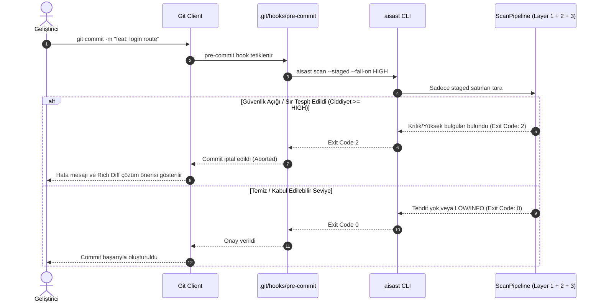
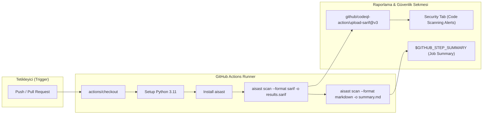

# AI-SAST (`aisast`) Dağıtım, Pre-Commit ve CI/CD Entegrasyon Rehberi

**Proje:** AI Destekli Kod Güvenliği & Sır Tarayıcı CLI (`aisast`)  
**Yazar & Geliştirici:** Yiğit Ali Çolakoğlu  
**Durum:** Kararlı Sürüm (v0.1.0 - Production Ready)

---

## 1. Giriş ve Genel Bakış

AI-SAST (`aisast`), modern DevSecOps boru hatlarına (DevSecOps Pipelines) tam uyum sağlayacak şekilde tasarlanmıştır. "Shift-Left" güvenlik felsefesi doğrultusunda zafiyetleri ve sızdırılmış sırları şu noktalarda engeller:

1. **Geliştirici Terminali (Pre-Commit):** Kod repoya commit edilmeden önce yerel olarak `git diff --staged` taraması yapar ve riskli kodları commit anında engeller.
2. **Pull Request & CI Aşaması (GitHub Actions):** PR açıldığında veya `main` dalına push yapıldığında tam tarama gerçekleştirir; **SARIF v2.1.0** raporunu GitHub Code Scanning sekmesine yükler ve **Markdown** formatındaki özet raporu PR yorumu olarak paylaşır.
3. **Konteynerize Dağıtım (Docker):** Herhangi bir Python bağımlılığı gerektirmeden bağımsız ve izole Docker konteyneri içinde çalıştırılabilir.

---

## 2. Pre-Commit Hook Entegrasyonu (`aisast init-hook`)

### 2.1 Tek Tıkla Otomatik Kurulum

Deponuzun kök dizininde aşağıdaki komutu çalıştırarak `.git/hooks/pre-commit` kancasını otomatik olarak oluşturabilirsiniz:

```bash
# Varsayılan kurulum (HIGH ve CRITICAL bulgularda commit bloklanır)
aisast init-hook

# Layer 3 AI doğrulamasını da pre-commit anında etkinleştirmek için
aisast init-hook --ai --fail-on CRITICAL

# Mevcut bir hook varsa üzerine yazmak için
aisast init-hook --force
```

### 2.2 Pre-Commit Bloklama Akışı (Sequence Diagram)

Aşağıdaki diyagramda geliştiricinin `git commit` komutunu vermesiyle başlayan otomatik denetim süreci gösterilmektedir:



---

## 3. Raporlama Biçimleri ve Kullanım Senaryoları

`aisast`, farklı tüketim kanalları için zengin raporlama formatlarını destekler:

| Format Türü | CLI Bayrağı | Kullanım Alanı | Açıklama |
|---|---|---|---|
| **Rich Console** | `-f rich` | Geliştirici Terminali | Renkli tablolar, zafiyetli satırlar (kırmızı `-`) ve önerilen yamalar (yeşil `+`) |
| **Markdown** | `-f markdown` / `-f md` | GitHub Job Summary & PR Comments | Tablolar, diff blokları ve çözüm adımlarını içeren GFM raporu |
| **SARIF** | `-f sarif` | GitHub Code Scanning & IDEs | OASIS SARIF v2.1.0 standardında yapılandırılmış güvenlik verisi |
| **JSON** | `-f json` | Özel Entegrasyonlar & Dashboardlar | Pydantic v2 `ScanResult` veri modelinin eksiksiz serileştirilmiş hali |

### 3.1 Terminalde Zengin Diff Önizlemesi

Tarama sonucunda bulunan zafiyetler için `ConsoleReporter`, kodun zafiyetli halini ve otomatik oluşturulan yamayı terminalde doğrudan gösterir:

```bash
aisast scan ./src
```

### 3.2 Markdown Raporu Oluşturma

```bash
# Markdown raporunu dosyaya kaydet
aisast scan ./src --format markdown -o security-report.md

# Doğrudan stdout üzerinden görüntüle
aisast scan ./src -f markdown
```

---

## 4. GitHub Actions CI/CD Entegrasyonu

### 4.1 Tam İş Akışı Boru Hattı (Flowchart)

Aşağıdaki akış şeması, GitHub Actions üzerinde kod push veya PR anında `aisast` çalışmasını ve SARIF / Markdown raporlarının nasıl işlendiğini gösterir:



### 4.2 Örnek GitHub Actions Workflow (`.github/workflows/security.yml`)

```yaml
name: "AI-SAST Security Scan"

on:
  push:
    branches: [ "main", "develop" ]
  pull_request:
    branches: [ "main" ]
  schedule:
    - cron: '0 2 * * 1' # Her Pazartesi gece yarısı tam tarama

jobs:
  security-audit:
    name: "Run aisast Security Audit"
    runs-on: ubuntu-latest
    permissions:
      contents: read
      security-events: write # SARIF yüklemesi için gereklidir
      pull-requests: write   # PR yorumu için gereklidir

    steps:
      - name: "Checkout Code"
        uses: actions/checkout@v4
        with:
          fetch-depth: 0

      - name: "Set up Python 3.11"
        uses: actions/setup-python@v5
        with:
          python-version: "3.11"
          cache: "pip"

      - name: "Install aisast"
        run: |
          python -m pip install --upgrade pip
          pip install git+https://github.com/yigitalic/AI-Destekli-Kod-Guvenlik.git

      - name: "Run aisast (SARIF Export)"
        id: sast_sarif
        run: |
          aisast scan . --format sarif --output aisast-results.sarif --fail-on HIGH || true
        env:
          AISAST_LLM_PROVIDER: "openai"
          OPENAI_API_KEY: ${{ secrets.OPENAI_API_KEY }}

      - name: "Run aisast (Markdown Summary)"
        run: |
          aisast scan . --format markdown --output scan-summary.md || true
          cat scan-summary.md >> $GITHUB_STEP_SUMMARY

      - name: "Upload SARIF to GitHub Code Scanning"
        uses: github/codeql-action/upload-sarif@v3
        if: always()
        with:
          sarif_file: aisast-results.sarif
          category: "aisast-security-scanner"

      - name: "Enforce Build Failure on High/Critical"
        run: |
          aisast scan . --fail-on HIGH
```

---

## 5. Docker Konteyner Dağıtımı

Python ortamını yerel makineye kurmadan `aisast`'ı izole bir Docker konteyneri içinde çalıştırabilirsiniz.

### 5.1 Docker İmajını İnşa Etme (Build)

```bash
docker build -t aisast:latest .
```

### 5.2 Konteyner Üzerinden Tarama Çalıştırma (Run)

Mevcut çalışma dizinini konteynerin `/workspace` dizinine bağlayarak (mount) tarama gerçekleştirilir:

```bash
# Linux / macOS
docker run --rm -v "$(pwd):/workspace" aisast:latest scan /workspace

# Windows PowerShell
docker run --rm -v "${PWD}:/workspace" aisast:latest scan /workspace

# SARIF çıktısını ana makineye kaydetme
docker run --rm -v "${PWD}:/workspace" aisast:latest scan /workspace -f sarif -o /workspace/aisast.sarif

# Layer 3 AI analizini ortam değişkeniyle etkinleştirme
docker run --rm \
  -e OPENAI_API_KEY="$OPENAI_API_KEY" \
  -v "${PWD}:/workspace" \
  aisast:latest scan /workspace --ai --provider openai
```

---

## 6. Özet ve Güvenlik Tavsiyeleri

1. **Geliştirici Ortamı:** Her geliştiricinin depoyu klonladıktan sonra `aisast init-hook` çalıştırması zorunlu kılınmalıdır.
2. **CI Kapısı (Quality Gate):** `--fail-on HIGH` parametresi ile pipeline'da HIGH ve CRITICAL bulguların ana dala birleşmesi kesin olarak engellenmelidir.
3. **Satır İçi İstisnalar:** Sahte alarmlar veya test amaçlı mock sırları için kodun sonuna `# aisast: ignore` eklenmelidir.
