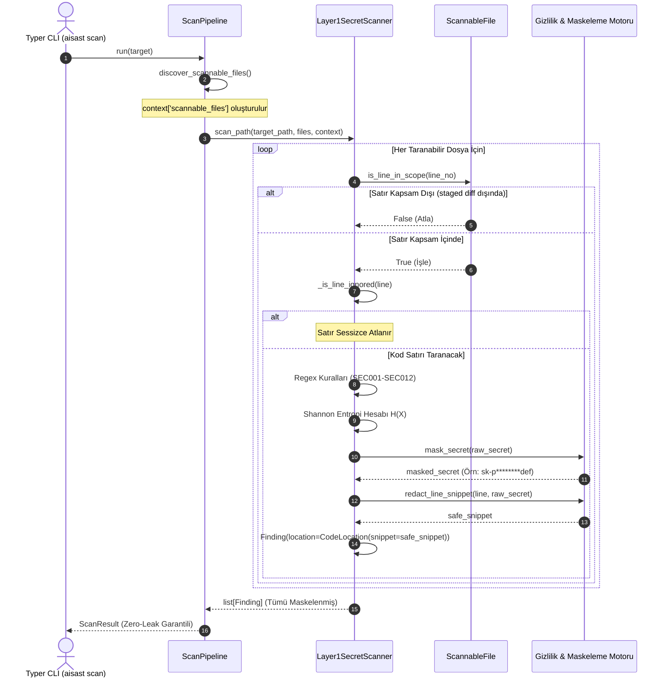

# AI-SAST Layer 1: Deterministik Sır & Entropi Avcısı ve Gizlilik Maskeleme Motoru

**Bileşen:** Layer 1 Sır Tarayıcısı (`src/aisast/layers/layer1_secrets.py`)  
**Mimari Fazı:** FAZ 2 (Layer 1: Sır & Entropi Avcısı ve Gizlilik Maskeleme Motoru)  
**Yazar & Geliştirici:** Yiğit Ali Çolakoğlu  
**Durum:** Tamamlandı & Doğrulandı  

---

## 1. Genel Bakış ve Amaç

Modern yazılım geliştirme süreçlerinde API anahtarları, bulut kimlik bilgileri, özel şifreleme anahtarları (Private Keys), JWT token'ları ve veritabanı bağlantı adresleri dikkatsizlik sonucu kaynak kod içerisine gömülebilmekte (hardcoded) ve kamuya açık depolara veya CI/CD loglarına sızabilmektedir.

**Layer 1**, `aisast` 3 katmanlı mimarisinin ilk savunma hattıdır:
1. **Deterministik ve Yüksek Hızlı Tarama:** LLM veya ağır AST analizlerine gerek duymadan, saniyede binlerce kod satırını saf Python ve C hızında regex motoruyla yerel olarak tarar.
2. **Shannon Entropi Analizi:** Belirli bir desene veya bilinen satıcı formatına uymayan rastgele şifreleme anahtarlarını, hash'leri ve parolaları bilgi kuramı (Information Theory) tabanlı Shannon Entropisi ile yakalar.
3. **Sıfır Sızıntı / Gizlilik Maskeleme (Zero-Leak Redaction):** Tespit edilen hiçbir sır terminal çıktısında, SARIF veya JSON raporlarında açık metin (plaintext) olarak gösterilmez (`mask_secret`). Ayrıca Layer 3'e (LLM API) gidecek kod blokları içindeki tüm sırlar `[REDACTED_SECRET]` ile temizlenir (`redact_secrets_in_text`).
4. **Kapsam ve İhmal Uyumu:** Satır içi yorumlar (`# aisast: ignore`, `# nosec`) ve `--staged` diff kapsamı (`ScannableFile.is_line_in_scope`) sayesinde yalnızca ilgili satırlar taranır.

---

## 2. Mimari Akış ve Karar Ağacı (Flowchart)

Aşağıdaki diyagram, bir kod satırının Layer 1 motoru tarafından baştan sona nasıl işlendiğini göstermektedir:

```mermaid
flowchart TD
    Start["Girdi: Dosya Satırı & Satır Numarası (line, line_no)"] --> InlineCheck{"Satır İçi İhmal Var mı?<br/>(# aisast: ignore, # nosec)"}
    InlineCheck -->|Evet| SkipLine["Satırı Atla (Bulgu Üretilmez)"]
    InlineCheck -->|Hayır| ScopeCheck{"Staged Diff Kapsamında mı?<br/>(is_line_in_scope)"}
    ScopeCheck -->|Hayır| SkipLine
    ScopeCheck -->|Evet| RegexStage["1. Aşama: Spesifik Regex Kuralları<br/>(SEC001 - SEC011 & Özel YAML Kuralları)"]

    RegexStage --> MatchRegex{"Eşleşme Var mı?"}
    MatchRegex -->|Evet| FPRegex{"False-Positive mi?<br/>(is_likely_false_positive_secret)"}
    FPRegex -->|Hayır| AddRegexFinding["Sırrı Kaydet (matched_secrets)<br/>Maskele (mask_secret)<br/>Finding Nesnesi Üret"]
    FPRegex -->|Evet| GenericStage
    AddRegexFinding --> GenericStage["2. Aşama: Genel Parola Atamaları<br/>(SEC012)"]
    MatchRegex -->|Hayır| GenericStage

    GenericStage --> MatchGeneric{"SEC012 Eşleşti mi?"}
    MatchGeneric -->|Evet| CheckDeduplicate{"Zaten Spesifik Kural<br/>Tarafından Yakalandı mı?"}
    CheckDeduplicate -->|Evet| EntropyStage
    CheckDeduplicate -->|Hayır| FPGeneric{"False-Positive mi?<br/>(Örnek/Placeholder/UUID/ENV)"}
    FPGeneric -->|Hayır| AddGenericFinding["Sırrı Kaydet<br/>Maskele (mask_secret)<br/>Finding Nesnesi Üret"]
    FPGeneric -->|Evet| EntropyStage
    AddGenericFinding --> EntropyStage["3. Aşama: Shannon Entropi Avcısı<br/>(SEC_ENTROPY_01)"]
    MatchGeneric -->|Hayır| EntropyStage

    EntropyStage --> FindQuoted["Tırnak İçi Aday Dizgeleri Çıkar<br/>['\"]([A-Za-z0-9+/=_-]{20,})['\"]"]
    FindQuoted --> CandidateCheck{"Aday Zaten Yakalandı mı<br/>veya Çakışan Aralıkta mı?"}
    CandidateCheck -->|Evet| NextCandidate["Sonraki Adayı İncele"]
    CandidateCheck -->|Hayır| CalcEntropy["Shannon Entropisi Hesapla: H(X)"]
    CalcEntropy --> EntropyThreshold{"H(X) >= entropy_threshold?<br/>(Varsayılan: 4.5)"}
    EntropyThreshold -->|Evet| FPEntropy{"False-Positive mi?<br/>(URL/Dosya Yolu/UUID/Harf Grubu)"}
    FPEntropy -->|Hayır| AddEntropyFinding["Maskele (mask_secret)<br/>SEC_ENTROPY_01 Finding Üret"]
    FPEntropy -->|Evet| NextCandidate
    EntropyThreshold -->|Hayır| NextCandidate
    AddEntropyFinding --> NextCandidate
    NextCandidate --> Output["Satır Bulgularını Listeye Ekle"]
```

---

## 3. Bileşen Etkileşimi (Sequence Diagram)

Layer 1'in `ScanPipeline`, `ScannableFile` ve `CodeLocation` modelleriyle olan orkestrasyonu:



---

## 4. Matematiksel Shannon Entropisi

Bilgi kuramında Shannon Entropisi, bir sembol dizisindeki belirsizlik veya rastgelelik miktarının ölçüsüdür:

$$H(X) = -\sum_{i=1}^{n} P(x_i) \log_2 P(x_i)$$

Burada:
- $n$: Karakter dizisindeki benzersiz karakter sayısıdır.
- $P(x_i)$: $x_i$ karakterinin tüm karakter dizisindeki bağıl sıklığıdır (frekansı):
  $$P(x_i) = \frac{\text{Karakterin Tekrar Sayısı}}{\text{Toplam Dize Uzunluğu}}$$
- $\log_2$: 2 tabanında logaritma olup, ölçü birimi **bit**tir.

### Entropi Değerlendirme Ölçeği

| Dize Türü | Örnek | Karakter Çeşitliliği | Tipik Entropi (Bit) | Eylem |
|---|---|---|---|---|
| Tek Karakter Tekrarı | `aaaaaaaaaaaaaaaaaaaa` | 1 | $0.00$ | Yanlış Pozitif (Elenir) |
| Doğal Dil Kelimeleri | `passwordadmin123` | Düşük | $2.80 - 3.40$ | Eşik altı (Spesifik regex yoksa elenir) |
| Standart UUID | `123e4567-e89b-12d3-a456-426614174000` | Orta | $3.50 - 4.10$ | UUID filtresi ile elenir |
| Rastgele API Token / Hash | `sk-proj-9xL8zQ2mV1bN5p...` | Çok Yüksek | $4.50 - 5.50$ | **ALARM (SEC_ENTROPY_01)** |
| Base64 Kodlu Kripto Anahtar | `U2FsdGVkX1+vupppZDm1+Y0388y6G...` | Maksimum | $4.60 - 6.00$ | **ALARM (SEC_ENTROPY_01)** |

> [!NOTE]
> Varsayılan eşik değeri `Layer1Config.entropy_threshold = 4.5` olarak ayarlanmıştır. Bu değer, hem yanlış alarmları engeller hem de kriptografik rastgeleliğe sahip token'ları yüksek doğrulukla yakalar.

---

## 5. Yerleşik Deterministik Kural Kataloğu (`DEFAULT_SECRET_RULES`)

Layer 1 motoru, endüstri standardı 12 yerleşik kural ile donatılmıştır:

| Kural ID | Kural Adı | Ciddiyet | Güven | Kategori | Eşleşen Grup | CWE / OWASP |
|---|---|---|---|---|---|---|
| **`SEC001`** | AWS Access Key ID | `CRITICAL` | `HIGH` | `SECRET_LEAK` | Grup 1 (`AKIA...`) | CWE-798 / A07:2021 |
| **`SEC002`** | AWS Secret Access Key Assignment | `CRITICAL` | `HIGH` | `SECRET_LEAK` | Grup 1 (40 karakterlik değer) | CWE-798 / A07:2021 |
| **`SEC003`** | OpenAI API Key | `CRITICAL` | `HIGH` | `SECRET_LEAK` | Grup 1 (`sk-proj-...`) | CWE-798 / A07:2021 |
| **`SEC004`** | Anthropic API Key | `CRITICAL` | `HIGH` | `SECRET_LEAK` | Grup 1 (`sk-ant-api03-...`) | CWE-798 / A07:2021 |
| **`SEC005`** | Google Cloud / Gemini API Key | `HIGH` | `HIGH` | `SECRET_LEAK` | Grup 1 (`AIza...`) | CWE-798 / A07:2021 |
| **`SEC006`** | GitHub Token (PAT/OAuth/App) | `CRITICAL` | `HIGH` | `SECRET_LEAK` | Grup 1 (`ghp_...`, `github_pat_...`) | CWE-798 / A07:2021 |
| **`SEC007`** | Stripe API Key | `CRITICAL` | `HIGH` | `SECRET_LEAK` | Grup 1 (`sk_live_...`, `rk_test_...`) | CWE-798 / A07:2021 |
| **`SEC008`** | Slack Token & Webhook | `HIGH` | `HIGH` | `SECRET_LEAK` | Grup 1 (`xoxb-...`, Webhook URI) | CWE-798 / A07:2021 |
| **`SEC009`** | Cryptographic Private Key | `CRITICAL` | `HIGH` | `SECRET_LEAK` | Grup 1 (`-----BEGIN ... PRIVATE KEY-----`) | CWE-798 / A07:2021 |
| **`SEC010`** | JSON Web Token (JWT) | `HIGH` | `MEDIUM` | `SECRET_LEAK` | Grup 1 (`eyJ...`) | CWE-798 / A07:2021 |
| **`SEC011`** | Database Connection URI | `CRITICAL` | `HIGH` | `HARDCODED_CREDENTIAL` | Grup 2 (Parola grubu) | CWE-798 / A07:2021 |
| **`SEC012`** | Generic Hardcoded Password/Secret | `HIGH` | `MEDIUM` | `HARDCODED_CREDENTIAL` | Grup 1 (Tırnak içi parola) | CWE-798 / A07:2021 |
| **`SEC_ENTROPY_01`** | High-Entropy Secret Candidate | `MEDIUM` | `LOW` | `SECRET_LEAK` | Tırnak içi rastgele token | CWE-798 / A07:2021 |

---

## 6. Yanlış Pozitif (False-Positive) Filtreleme Mimarisi

Geliştiricilerin araca olan güvenini korumak için `is_likely_false_positive_secret` fonksiyonu şu filtreleri uygular:

1. **Örnek ve Sahte Kelimeler (Placeholders):** `example`, `placeholder`, `your_api_key`, `your-api-key`, `changeme`, `dummy`, `sample`, `test_key`, `xxxxxx`, `123456`, `abcdef` gibi geliştirme esnasında yazılan şablon değerler elenir.
2. **Ortam Değişkeni Referansları:** `${...}`, `$ENV`, `os.getenv("...")`, `os.environ["..."]`, `process.env....` referansları kaynak koddaki gerçek sır değil, güvenli okuma kalıpları olduğu için alarmlara dönüştürülmez.
3. **Standart UUID:** `^[0-9a-fA-F]{8}-[0-9a-fA-F]{4}-[0-9a-fA-F]{4}-[0-9a-fA-F]{4}-[0-9a-fA-F]{12}$` deseni veritabanı ID'si veya işlem takip numarası olduğu için elenir.
4. **Dosya Yolları ve URL'ler:** `http://`, `https://` (Slack webhook hariç), `/usr/`, `C:\` ve dosya uzantıları (`.png`, `.jpg`, `.json`, `.yaml`, vb.) elenir.
5. **Doğal Dil Kelimeleri:** Rakam veya özel sembol içermeyen sadece harflerden oluşan sınıf/metot isimleri (`UserAuthenticationServiceManager`) elenir.

---

## 7. Gizlilik Koruması (Secret Redaction) ve Maskeleme

### A. `mask_secret`
Terminal raporlarında ve dışa aktarılan dosyalarda sırrın güvenli temsilini üretir:
- Uzunluğu $\le 8$ karakter olan sırlar: Tamamı `*` karakteri ile kapatılır (`"********"`).
- Uzunluğu $> 8$ karakter olan sırlar: Başından `visible_prefix` (varsayılan 4) ve sonundan `visible_suffix` (varsayılan 3) karakter gösterilir; orta kısım `********` ile gizlenir.
- **Örnek:** `sk-proj-1234567890abcdef` $\rightarrow$ `sk-p********def`

### B. `redact_line_snippet`
Raporlanan `Finding.location.snippet` alanı içindeki açık metin sırrı, `mask_secret` sonucuyla yer değiştirir:
```python
# Ham Kod:
api_key = "sk-proj-1234567890abcdef"
# Snippet Çıktısı:
api_key = "sk-p********def"
```

### C. `redact_secrets_in_text` (Layer 3 LLM Gizlilik Kalkanı)
Bir dosyanın veya fonksiyon gövdesinin Layer 3 LLM API'sine gönderilmeden önce içindeki tüm sırları temizleyen güvenlik kalkanıdır:
```python
clean_code = redact_secrets_in_text(raw_code, custom_replacement="[REDACTED_SECRET]")
```

---

## 8. Özel Kural Yükleyici (`custom_rules_path`)

Kurumsal veya projeye özgü özel sır formatları, `.aisast.yaml` dosyasında `layer1.custom_rules_path` belirtilerek YAML üzerinden tanımlanabilir:

```yaml
rules:
  - rule_id: "CORP001"
    title: "Internal Corporate Auth Token"
    description: "Şirket içi SSO yetkilendirme jetonu tespit edildi."
    pattern: "\\b(corp_sso_[A-Za-z0-9]{32})\\b"
    severity: "CRITICAL"
    confidence: "HIGH"
    category: "SECRET_LEAK"
    secret_group: 1
```
Tüm özel kurallar, yerleşik kurallarla aynı pipeline aşamalarında doğrulanarak raporlanır.
