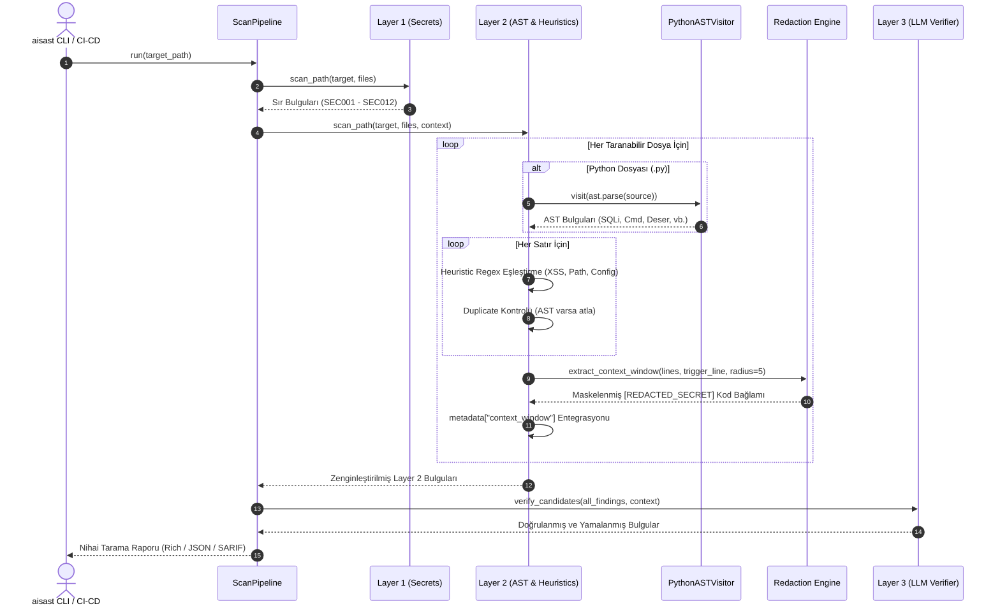

# AI-SAST (`aisast`) Layer 2: AST & Sezgisel Statik Kod Analizi ve Bağlam Penceresi Dokümantasyonu

**Bileşen:** Layer 2 AST & Heuristic Static Analyzer (`aisast.layers.layer2_heuristics`)  
**Yazar & Geliştirici:** Yiğit Ali Çolakoğlu  
**Durum:** Tamamlandı & Doğrulandı  
**Tarih:** Ekim 2026  

---

## 1. Giriş ve Mimari Amaç

Layer 2, `aisast` 3 katmanlı tarama hunisinin (Tri-Layer Hybrid Funnel) orta omurgasını oluşturur. Temel görevi, kaynak kodları ayrıştırarak karmaşık sözdizimsel ve mantıksal zafiyet adaylarını (SQL Injection, Command Injection, Insecure Deserialization, XSS, Weak Crypto vb.) yakalamak ve maliyetli Layer 3 (LLM) doğrulamasına yalnızca yüksek kaliteli, filtrelenmiş şüpheli adayları iletmektir.

### Temel Prensipler
1. **İki Aşamalı Hibrit Tarama (Two-Phase Hybrid Scanning):**
   - **Aşama 1 (Python AST Semantik Çözümleme):** Python dosyalarını (`.py`, `.pyw`) `ast.NodeVisitor` ile sözdizim ağacına ayırır. Dinamik metin birleştirmelerini, operatörleri (`+`, `%`), f-string yapılarını ve fonksiyon parametrelerini (`shell=True`, `verify=False`, `Loader=...`) semantik olarak denetler.
   - **Aşama 2 (Çoklu Dil Sezgisel Desen Motoru):** Python, JavaScript, TypeScript, PHP, Go, Java vb. dillerde bilinen zafiyet kalıplarını (DOM XSS, ham SQL birleştirmesi, `child_process.exec`, `DEBUG=True`, CORS `*`) regex kataloglarıyla tarar.
2. **Sıfır Yanlış Pozitif (Zero False-Positive) Stratejisi:**
   - Parametreli SQL sorguları (`cursor.execute("SELECT * FROM t WHERE id = ?", (uid,))`), `subprocess.run(..., shell=False)`, `ast.literal_eval()`, `yaml.safe_load()` ve `hashlib.sha256()` gibi güvenli kod kalıplarında **kesinlikle bulgu üretilmez**.
3. **AST-Heuristic Mükerrer (Duplicate) Önleme:**
   - Aynı satırda ve aynı zafiyet kategorisinde AST kuralı zaten bir bulgu ürettiyse, Heuristic motor mükerrer alarm üretmez; AST bulgusu öncelikli kabul edilir.
4. **Gizlilik Korumalı Bağlam Penceresi (Privacy-Preserving Context Window):**
   - Her bulgu için tetikleyici satırın $\pm 5$ satırlık çevresel kod bağlamı çıkarılır. Kod içindeki olası API anahtarları veya sırlar `redact_secrets_in_text()` fonksiyonu ile `[REDACTED_SECRET]` olarak maskelenerek `Finding.metadata["context_window"]` içine gömülür. Bu sayede Layer 3 LLM'e asla gerçek sırlar iletilmez.

---

## 2. Mimari ve Veri Akış Diyagramları

### A. Layer 2 Yürütme Boru Hattı (Flowchart)

```mermaid
flowchart TD
    Start["Girdi: Taranacak Dosya Yolları (ScannableFile)"] --> CheckExt{"Dosya Tipi Python mı? (.py / .pyw)"}

    subgraph Phase1["1. Aşama: Python AST Semantik Analiz Motoru"]
        CheckExt -->|Evet ve config.enable_ast| ParseAST["ast.parse(source_code)"]
        ParseAST -->|Başarılı| ASTVisitor["PythonASTVulnerabilityVisitor (ast.NodeVisitor)"]
        ParseAST -->|SyntaxError / ValueError| CatchSyntax["Hata Yakalama (Çökmeden Devam Et)"]
        
        ASTVisitor --> CheckAssign["visit_Assign: Dinamik SQL Değişken Takibi"]
        ASTVisitor --> CheckCall["visit_Call: Tehlikeli Fonksiyon ve Argüman Denetimi"]
        
        CheckCall --> AST_Rules["AST Kuralları:<br/>- AST_SQLI_01 (f-string, %, +, .format)<br/>- AST_CMD_01 (os.system, shell=True)<br/>- AST_EXEC_01 (eval, exec)<br/>- AST_DESER_01 (pickle, yaml.load)<br/>- AST_CRYPTO_01 (md5, sha1)<br/>- AST_TLS_01 (verify=False)<br/>- AST_PATH_01 (tempfile, request.file)"]
        
        AST_Rules --> AST_Findings["AST Bulguları Havuzu"]
    end

    subgraph Phase2["2. Aşama: Çoklu Dil Sezgisel (Heuristic) Motoru"]
        CheckExt -->|Hayır veya AST Sonrası| HeurScan["Satır Satır Regex Desen Eşleştirme"]
        CatchSyntax --> HeurScan
        AST_Findings --> HeurScan

        HeurScan --> FilterDup{"Aynı Satır ve Kategoride<br/>AST Bulgusu Var mı?"}
        FilterDup -->|Evet| SkipDup["Mükerrer Bulgu Önleme (Atla)"]
        FilterDup -->|Hayır| CheckHeur["Heuristic Kuralları:<br/>- HEUR_XSS_01 (.innerHTML, dangerouslySetInnerHTML)<br/>- HEUR_SQLI_01 (Multi-lang raw SQL + var)<br/>- HEUR_CMD_01 (child_process.exec, shell_exec)<br/>- HEUR_PATH_01 (readFile + req.query, ../)<br/>- HEUR_CONF_01 (DEBUG=True, CORS *)"]
        CheckHeur --> Heur_Findings["Heuristic Bulguları"]
    end

    subgraph Phase3["3. Aşama: Filtreleme ve Gizlilik Bağlam Penceresi"]
        AST_Findings --> CombinedFindings["Ham Bulgular"]
        Heur_Findings --> CombinedFindings
        
        CombinedFindings --> CheckIgnore{"Satır İçi Ignore Var mı?<br/>(# aisast: ignore, # nosec)"}
        CheckIgnore -->|Evet| DropFinding["Bulguyu İhmal Et"]
        CheckIgnore -->|Hayır| CheckStaged{"Git diff --staged Kapsamında mı?<br/>(is_line_in_scope)"}
        CheckStaged -->|Hayır| DropFinding
        CheckStaged -->|Evet| CheckSev{"Ciddiyet >= Eşik?<br/>(rule_severity_threshold)"}
        CheckSev -->|Hayır| DropFinding
        
        CheckSev -->|Evet| CtxWindow["extract_context_window(+-5 satır)"]
        CtxWindow --> RedactSecret["redact_secrets_in_text() (Sırları Maskele)"]
        RedactSecret --> EmbedMeta["metadata['context_window'] Ekle"]
        EmbedMeta --> FinalOut["Sonuç: Doğrulanmış Layer 2 Bulguları"]
    end
```



---

### B. Boru Hattı Sıralama Diyagramı (Sequence Diagram)



---

## 3. CWE / OWASP Kural Kataloğu Matrisi

### A. Python AST Tabanlı Kurallar

| Kural Kimliği | Kural Başlığı | Hedef CWE | OWASP Top 10 | Varsayılan Ciddiyet | Güven Seviyesi | Tespit Mantığı ve Kriterler | Yanlış Pozitif Önleme (Güvenli Kalıplar) |
|---|---|---|---|---|---|---|---|
| **`AST_SQLI_01`** | SQL Injection (Dynamic SQL Construction) | `CWE-89` | A03:2021 - Injection | `CRITICAL` | `HIGH` | `execute`, `raw`, `extra`, `text` çağrılarında ilk argümanın f-string (`JoinedStr`), `+` / `%` (`BinOp`), `.format()` olması veya önceden dinamik SQL atanan değişken olması. Ayrıca SQL regex kalıbı içeren doğrudan atamalar. | `cursor.execute("SELECT * FROM t WHERE id = ?", (uid,))` gibi parametreli sabit sorgularda **0 bulgu**. |
| **`AST_CMD_01`** | OS Command Injection / Unsafe Shell | `CWE-78` | A03:2021 - Injection | `CRITICAL` | `HIGH` | `os.system(...)`, `os.popen(...)`, `commands.getstatusoutput(...)` çağrıları veya `subprocess` fonksiyonlarında `shell=True` parametresi. | `subprocess.run(["ls", "-la"], shell=False)` veya liste parametreli güvenli çağrılarda **0 bulgu**. |
| **`AST_EXEC_01`** | Dangerous Dynamic Code Execution | `CWE-95` | A03:2021 - Injection | `HIGH` | `HIGH` | Yerleşik `eval(...)` veya `exec(...)` çağrıları. | `ast.literal_eval(...)` çağrısı güvenlidir ve **hariç tutulur**. |
| **`AST_DESER_01`** | Insecure Deserialization | `CWE-502` | A08:2021 - Integrity Failures | `CRITICAL` | `HIGH` | `pickle.load(s)`, `dill.load(s)`, `marshal.load(s)`, `shelve.open()` ve `yaml.unsafe_load()` veya `yaml.load()` çağrısında `Loader=SafeLoader` olmaması. | `yaml.safe_load(...)` ve `yaml.load(..., Loader=SafeLoader)` çağrılarında **0 bulgu**. |
| **`AST_CRYPTO_01`**| Weak Cryptographic Hash | `CWE-328` | A02:2021 - Cryptographic Failures | `MEDIUM` | `HIGH` | `hashlib.md5(...)`, `hashlib.sha1(...)` veya `hashlib.new("md5"/"sha1")` çağrıları. | `usedforsecurity=False` parametresi belirtilmişse veya `sha256/sha512` ise **0 bulgu**. |
| **`AST_TLS_01`**   | Disabled SSL/TLS Verification | `CWE-295` | A07:2021 - Auth Failures | `HIGH` | `HIGH` | `requests` veya `httpx` isteklerinde `verify=False` kullanılması ya da `ssl._create_unverified_context()` çağrısı. | Standart sertifika doğrulaması aktif çağrılarda (`verify=True` veya varsayılan) **0 bulgu**. |
| **`AST_PATH_01`**  | Potential Path Traversal / Temp File | `CWE-22`, `CWE-377` | A01:2021 - Broken Access Control | `MEDIUM` | `MEDIUM` | `tempfile.mktemp()` kullanımı veya `open()` / `os.remove()` fonksiyonuna doğrudan `request.` özniteliği aktarılması. | `tempfile.NamedTemporaryFile` ve güvenli yol çözümleme işlemlerinde **0 bulgu**. |

---

### B. Çoklu Dil Sezgisel (Heuristic Regex) Kuralları

| Kural Kimliği | Kural Başlığı | Hedef Diller | Hedef CWE | OWASP Top 10 | Varsayılan Ciddiyet | Regex Kalıbı ve Açıklama |
|---|---|---|---|---|---|---|
| **`HEUR_XSS_01`** | Cross-Site Scripting (DOM XSS) | JS, TS, JSX, HTML, Python | `CWE-79` | A03:2021 - Injection | `HIGH` | `(?i)(?:\.innerHTML\s*=\|\.outerHTML\s*=\|document\.write\s*\(...\|dangerouslySetInnerHTML\s*=)`<br/>DOM içine doğrudan filtrelenmemiş veri aktarımı. |
| **`HEUR_SQLI_01`**| Heuristic Raw SQL Concatenation | Çoklu (JS/TS/PHP/Java/Go) | `CWE-89` | A03:2021 - Injection | `CRITICAL` | `(?i)["'\`]\s*(?:SELECT.+?FROM\|INSERT\s+INTO...).*?(?:["']\s*\+\s*[a-zA-Z_$]\|\$\{[^}]+\})`<br/>Ham SQL metninde string concat veya template literal kullanımı. |
| **`HEUR_CMD_01`** | Heuristic Shell Execution | Node.js, PHP, Shell | `CWE-78` | A03:2021 - Injection | `CRITICAL` | `\b(?:child_process\.exec\|child_process\.execSync\|shell_exec\|passthru\|proc_open)\s*\(`<br/>Kabuk üzerinde doğrudan komut yürütme fonksiyonları. |
| **`HEUR_PATH_01`**| Heuristic Path Traversal | JS, TS, Python, PHP | `CWE-22` | A01:2021 - Broken Access Control | `HIGH` | `(?:open\|send_file\|readFile\|include)\s*\([^)]*(?:request\.(?:args\|form)\|req\.(?:query\|params)\|\.\./)`<br/>Dosya işlemlerinde kullanıcı girdisi veya üst dizin (`../`) kullanımı. |
| **`HEUR_CONF_01`**| Insecure Debug / Wildcard CORS | Python, JS, JSON, Config | `CWE-489` | A05:2021 - Security Misconfiguration | `MEDIUM` | `(?i)(?:^\s*DEBUG\s*=\s*True\b\|\.run\s*\([^)]*\bdebug\s*=\s*True\b\|['"]Access-Control-Allow-Origin['"](?:\s*\])?\s*[:=]\s*['"]\*['"])`<br/>Canlıda açık bırakılan hata ayıklama modu veya wildcard CORS. |

---

## 4. Gizlilik Korumalı Bağlam Penceresi (`extract_context_window`)

### Amaç ve Tasarım
Layer 3 (LLM) doğrulama motorunun yanlış pozitifleri ayıklayabilmesi ve otomatik yama (`secure_code_patch`) üretebilmesi için sadece tek satırlık bir kod parçacığı yetersizdir. Ancak zafiyetli kodun çevresinde geliştiricilerin unuttuğu hassas API anahtarları veya veritabanı parolaları bulunabilir.

`extract_context_window()` fonksiyonu, zafiyetli satırın $\pm 5$ satırlık çevresini alır ve metni **Layer 1 Gizlilik Kalkanı (`redact_secrets_in_text`)** üzerinden geçirir.

### Veri Yapısı
Her üretilen `Finding.metadata["context_window"]` sözlüğü aşağıdaki şemaya sahiptir:
```json
{
  "context_start_line": 17,
  "context_end_line": 27,
  "trigger_line": 22,
  "context_code": "def login_handler(username: str, password: str):\n    conn = sqlite3.connect(\"app.db\")\n    cursor = conn.cursor()\n    API_SECRET = \"[REDACTED_SECRET]\"\n    query = f\"SELECT * FROM users WHERE username = '{username}'\"\n    cursor.execute(query)"
}
```

---

## 5. Filtreler, Kapsam ve Hata Toleransı

1. **Satır İçi İhmal (Inline Ignore):**
   - Kod satırında `# aisast: ignore`, `# nosec`, `// aisast: ignore`, `/* aisast: ignore */` veya `// nosec` etiketlerinden biri varsa kural tetiklenmez.
2. **Git Diff `--staged` Kapsamı:**
   - Pre-commit hook modunda (`--staged`), yalnızca `git diff --staged -U0` ile değiştiği belirlenen satır aralıkları (`ScannableFile.is_line_in_scope`) taranır. Değişmeyen eski satırlar raporlanmaz.
3. **Ciddiyet Eşiği Filtresi (`rule_severity_threshold`):**
   - Yapılandırmada belirtilen ciddiyetin altındaki kurallar (örn: eşik `HIGH` ise `MEDIUM` olan zayıf hash kuralları) raporlanmaz.
4. **Sözdizim Hatası Toleransı (`SyntaxError` Graceful Fallback):**
   - Eksik parantez veya geçersiz Python sözdizimi içeren dosyalarda `ast.parse` başarısız olduğunda sistem çökmez; hata sessizce yakalanır ve dosya Heuristic regex motoru ile taranmaya devam eder.

---

## 6. Doğrulama ve Performans Metrikleri

- **Birim Testleri:** `tests/test_layer2_heuristics.py` altında **30 adet** kapsamlı birim testi bulunmaktadır (Tüm test paketi: **84 test**).
- **Tarama Süresi:** 50+ satırlık bir kaynak kod dosyası için Layer 1 + Layer 2 toplam tarama süresi **~0.01 saniye (10 ms)** civarındadır.
- **Bellek ve CPU:** Sıfır dış bağımlılık (yalnızca Python yerleşik `ast` modülü ve optimize regex motoru). API maliyeti sıfırdır.
