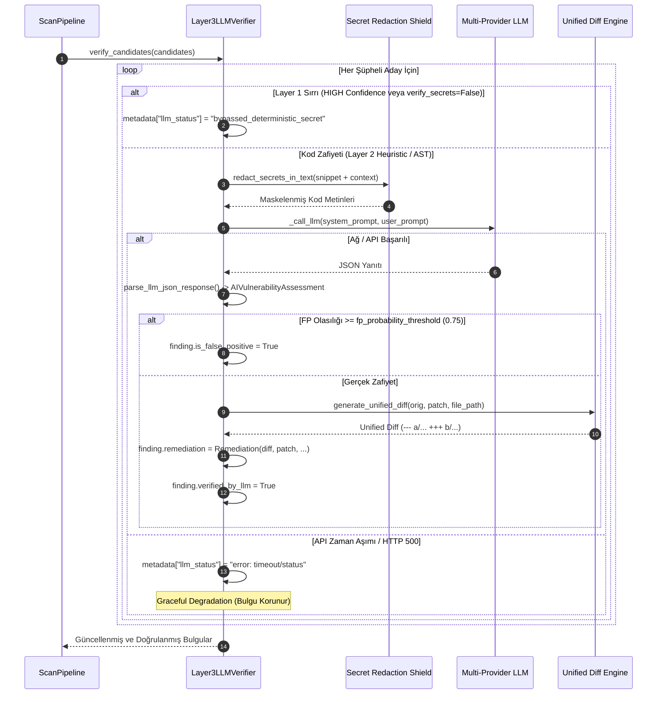
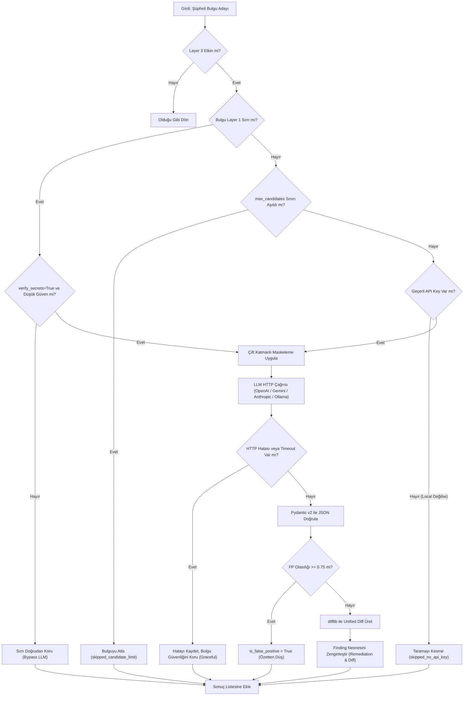

# Layer 3: AI / LLM Bağlamsal Zafiyet Doğrulama & Otomatik Patch Motoru

**Modül:** `src/aisast/layers/layer3_llm.py`  
**Yazar & Geliştirici:** Yiğit Ali Çolakoğlu  
**Durum:** Tamamlandı & Doğrulandı  

---

## 1. Giriş ve Amaç

Statik Kod Analizi (SAST) ve Regex tabanlı sır tespit araçlarının en büyük dezavantajı, kodun çalışma mantığını ve bağlamını anlamadan aşırı miktarda **yanlış pozitif (False Positive)** üretmeleridir. Geleneksel yaklaşımlar geliştiricileri yüzlerce sahte uyarı içinde boğarken, kritik açıkların gözden kaçmasına neden olur.

**Layer 3 AI / LLM Motoru**, `aisast` 3 katmanlı filtreleme hunisinin en üst ve en akıllı katmanıdır. Temel hedefleri:
1. **Bağlamsal Doğrulama:** Layer 1 ve Layer 2'den gelen şüpheli aday bulguları derinlemesine analiz eder.
2. **Yanlış Pozitifleri Eleme:** `false_positive_probability` metriğiyle güvenli yapıları (sanitize edilmiş girdiler, parametreli sorgular, test fikstürleri) otomatik olarak eler.
3. **Otomatik Güvenli Yama (Unified Diff):** Zafiyetli kod satırları için geliştiricinin doğrudan `git apply` ile uygulayabileceği standart Unified Diff yamaları üretir.
4. **Çift Katmanlı Gizlilik Kalkanı (Double-Redaction):** Kaynak kod parçacıkları dış LLM API'lerine gönderilmeden önce tüm hassas sırlar (API anahtarları, tokenlar, şifreler) maskelenir.
5. **Kesintisiz Çalışma (Graceful Degradation):** Ağ gecikmeleri, zaman aşımları veya HTTP hataları durumunda tarama asla çökmez; mevcut bulgular korunarak süreç tamamlanır.

---

## 2. Çift Katmanlı Gizlilik Kalkanı (Double-Redaction Guarantee)

Güvenlik analiz araçlarının en hassas noktası, analiz için dış yapay zeka sağlayıcılarına (OpenAI, Gemini, Anthropic vb.) veri gönderirken müşteri veya kurum sırlarını sızdırma riskidir.

`aisast`, bu riski **Çift Katmanlı Gizlilik Kalkanı** ile sıfıra indirir:
- **1. Aşama (Layer 2 Bağlam Çıkarıcı):** Zafiyetli satırın $\pm 5$ satırlık çevresi (`extract_context_window`) taranırken `redact_secrets_in_text()` uygulanır.
- **2. Aşama (Layer 3 Prompt Builder):** `build_verification_prompt(finding)` fonksiyonu, dış dünyaya prompt metni üretmeden önce hem `snippet` hem de `context_code` üzerinde **ikinci kez** `redact_secrets_in_text()` çalıştırarak çift garanti sağlar.

Hiçbir AWS Key, OpenAI/Anthropic/Gemini Token, Private Key veya JWT açık metin olarak LLM sunucularına iletilemez; hepsi `[REDACTED_SECRET]` ile maskelenir.

---

## 3. Yapılandırılmış Çıktı Şeması (`AIVulnerabilityAssessment`)

Layer 3, serbest metin (unstructured text) üreten LLM yanıtları yerine kesin tip garantili **Pydantic v2** şeması kullanır:

```python
class AIVulnerabilityAssessment(BaseModel):
    model_config = ConfigDict(extra="ignore")

    vulnerability_type: str
    cwe_id: str
    severity: SeverityLevel
    line_number: int = Field(ge=1)
    explanation: str
    secure_code_patch: str
    false_positive_probability: float = Field(ge=0.0, le=1.0)
```

### JSON Çıktı Örneği
```json
{
  "vulnerability_type": "SQL Injection",
  "cwe_id": "CWE-89",
  "severity": "CRITICAL",
  "line_number": 42,
  "explanation": "f-string kullanılarak kullanıcı parametresi doğrudan SQL sorgusu içine gömülmüş. Parametreli sorgu yapısına geçilmeli.",
  "secure_code_patch": "cursor.execute(\"SELECT * FROM users WHERE id = %s\", (user_id,))",
  "false_positive_probability": 0.02
}
```

---

## 4. Çoklu Sağlayıcı Mimarisi (Multi-Provider Engine)

`Layer3LLMVerifier`, yerleşik `httpx.Client` kullanarak modern LLM sağlayıcılarını doğrudan destekler:

| Sağlayıcı | API Tipi / URL | Kimlik Doğrulama | Özel Ayarlar |
|---|---|---|---|
| **OpenAI** | `https://api.openai.com/v1/chat/completions` | `Authorization: Bearer <key>` | `response_format: {"type": "json_object"}` |
| **Gemini** | `https://generativelanguage.googleapis.com/...` | Query parametresi `key=<key>` | `responseMimeType: "application/json"` |
| **Anthropic** | `https://api.anthropic.com/v1/messages` | `x-api-key: <key>` | `max_tokens: 1024`, `system` |
| **Ollama / Local** | `http://localhost:11434/api/chat` | Yerel (Anahtarsız) | `format: "json"`, `stream: False` |

Kullanıcı kendi özel kurumsal LLM proxy'sini veya vLLM/Ollama sunucusunu kullanmak istediğinde `--provider` ve `base_url` parametreleriyle tam uyumluluk sağlanır.

---

## 5. Mimari Akış ve Karar Diyagramları

### A. Uçtan Uca Doğrulama Sıralama Diyagramı (Sequence Diagram)



---

### B. Karar ve Filtreleme Mantığı (Flowchart TD)



---

## 6. Standart Unified Diff Yama Motoru

LLM tarafından önerilen `secure_code_patch` alanı doğrudan kaynak kodla karşılaştırılarak standart `difflib.unified_diff` formatına dönüştürülür:

```diff
--- a/src/users.py
+++ b/src/users.py
@@ -42,1 +42,1 @@
-cursor.execute(f"SELECT * FROM users WHERE id = {user_id}")
+cursor.execute("SELECT * FROM users WHERE id = %s", (user_id,))
```

Bu diff metni `Finding.remediation.diff` alanında depolanır ve CI/CD ortamlarında veya IDE eklentilerinde doğrudan tek tıkla uygulanabilir.

---

## 7. Kullanım ve CLI Entegrasyonu

### CLI Bayrakları
```bash
# Layer 3 AI analizini zorunlu etkinleştir
aisast scan ./src --ai --provider openai --model gpt-4o-mini

# Layer 3 AI analizini devre dışı bırak (yalnızca L1 + L2)
aisast scan ./src --no-ai

# Yerel Ollama modeliyle gizlilik odaklı tarama
aisast scan ./src --ai --provider ollama --model llama3:8b
```

### Yapılandırma Dosyası (`.aisast.yaml`)
```yaml
layer3:
  enabled: true
  provider: "openai"
  model: "gpt-4o-mini"
  api_key: null  # Ortam değişkeninden (OPENAI_API_KEY) okunur
  base_url: null
  max_candidates: 30
  temperature: 0.1
  timeout_seconds: 30.0
  fp_probability_threshold: 0.75
  verify_secrets: false
```
