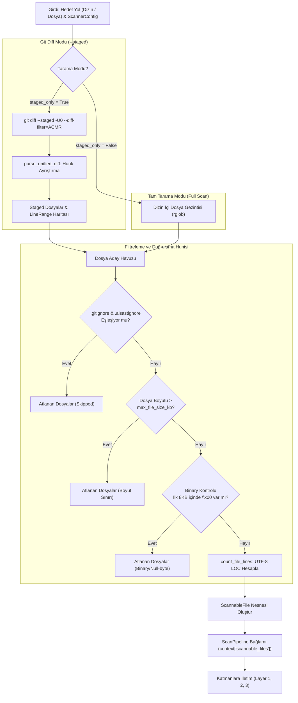
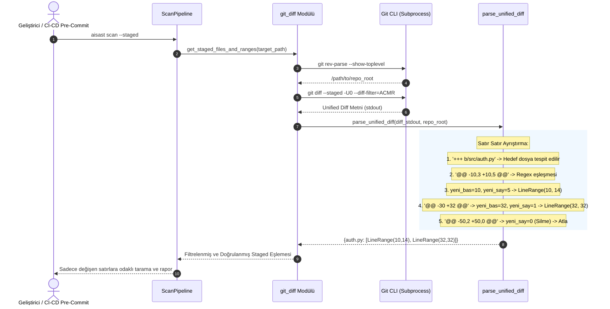
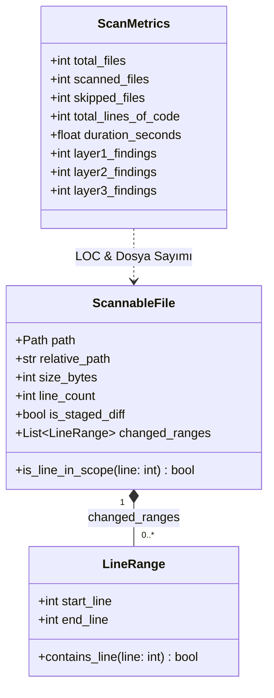

# AI-SAST Git & Dosya Tarama Motoru (Scanner Engine)

**Bileşen:** AI-SAST Dosya Keşfi, Ignore Filtreleme & Git Diff Hunk Ayrıştırıcı  
**Mimari Fazı:** FAZ 1 (Git & Dosya Tarama Motoru)  
**Yazar & Geliştirici:** Yiğit Ali Çolakoğlu  
**Durum:** Tamamlandı & Doğrulandı  

---

## 1. Genel Bakış ve Amaç

Statik Kod Analizi (SAST) ve Sır Tarama (Secret Scanning) araçlarında performans ve doğruluk, tarama motoruna beslenen dosyaların kalitesine doğrudan bağlıdır. Gereksiz bağımlılık dizinlerinin (`node_modules`, `venv`), derlenmiş ikili dosyaların (`.exe`, `.dll`, `.png`, `.bin`), büyük arşivlerin veya commit edilmeyecek dosyaların taranması; gereksiz CPU tüketimine, yüksek bellek harcamasına ve sahte alarmlara (False Positive) yol açar.

Ayrıca modern CI/CD boru hatlarında ve pre-commit kancalarında (git pre-commit hook) **tüm depoyu baştan sona taramak yerine sadece değiştirilen satırların (`git diff --staged`) taranması** geliştirici deneyimini katbekat hızlandırır.

FAZ 1 kapsamında geliştirilen **AI-SAST Scanner Engine** şu temel yetenekleri sunar:
1. **Dinamik Ignore Motoru:** Varsayılan dışlama kalıplarına ek olarak disk üzerindeki `.gitignore` ve `.aisastignore` dosyalarını otomatik okur, birleştirir ve tekrarları eler.
2. **İçerik Bazlı Binary Tespiti:** Uzantıdan bağımsız olarak dosyanın ilk 8192 baytında null-byte (`\x00`) kontrolü yaparak ikili ve derlenmiş dosyaları güvenle atlar.
3. **Unified Diff Hunk Ayrıştırıcı:** `git diff --staged -U0` çıktısını ayrıştırarak dosya bazında sadece eklenen ve değiştirilen satır aralıklarını (`LineRange`) çıkarır.
4. **Kapsam Farkındalığı (`ScannableFile`):** Katmanlara (Layer 1, 2, 3) taranacak dosyanın tüm satırlarının mı yoksa sadece belirli satırlarının mı denetleneceğini bildiren bağlamsal model sağlar.
5. **Gerçek LOC (Lines of Code) Sayımı:** Taranabilir metin dosyalarının toplam satır sayısını UTF-8 uyumlu biçimde hesaplayarak `ScanMetrics.total_lines_of_code` metriğini besler.

---

## 2. Dosya Keşif ve Filtreleme Hunisi (Flowchart)

Tarama motoru, verilen hedef yolu iki farklı modda işleyebilen bir filtreleme hunisi (`discover_scannable_files`) üzerinden çalıştırır:



---

## 3. Unified Diff Hunk Ayrıştırma Akışı (Sequence Diagram)

`git diff --staged --unified=0` çıktısı, dosyada yapılan ekleme ve değişiklikleri atomik "hunk" blokları olarak verir. Diff Hunk Parser bu blokları satır aralıklarına dönüştürür.



### Hunk Başlığı Regex Mantığı

Unified diff hunk başlıkları standart olarak şu biçimdedir:
```text
@@ -eski_baslangic[,eski_adet] +yeni_baslangic[,yeni_adet] @@ [isteğe bağlı fonksiyon başlığı]
```

Kullanılan Regex Deseni:
```python
HUNK_PATTERN = re.compile(r"^@@ -\d+(?:,\d+)? \+(\d+)(?:,(\d+))? @@")
```

Ayrıştırma Kuralları:
- `yeni_baslangic = int(match.group(1))`
- `yeni_adet = int(match.group(2)) if match.group(2) is not None else 1`
- `yeni_adet == 0`: Sadece satır silinmiştir, yeni satır eklenmemiştir. Bu hunk için `LineRange` üretilmez.
- `yeni_adet > 0`: `start_line = yeni_baslangic`, `end_line = yeni_baslangic + yeni_adet - 1` formülüyle `LineRange` oluşturulur.
- `+++ /dev/null`: Silinmiş dosyalar eşleme havuzuna dahil edilmez.

---

## 4. Çekirdek Veri Modelleri (Class Diagram)

Tarama kapsamı ve satır aralıkları, **Pydantic v2** tabanlı modellerle doğrulanır:



### `ScannableFile.is_line_in_scope(line: int) -> bool`
Katmanlar (Layer 1 sır avcısı, Layer 2 AST denetleyicisi) bir bulgu ürettiğinde, bulgunun satır numarasını bu metoda sorarak tarama kapsamı dışında kalan eski kod satırlarını sessizce filtreleyebilir:
```python
if not self.is_staged_diff or not self.changed_ranges:
    return True
return any(r.contains_line(line) for r in self.changed_ranges)
```

---

## 5. Filtreleme ve İkili (Binary) Koruma Mekanizmaları

### A. Null-Byte (`\x00`) Tespiti (`is_binary_file`)
Metin tabanlı kaynak kodlar UTF-8 / ASCII biçimindedir. Derlenmiş kütüphaneler (`.so`, `.dll`), ikili çalıştırılabilirler (`.exe`, ELF), resimler (`.png`, `.jpg`) ve sıkıştırılmış arşivler ilk baytlarında null byte (`\x00`) barındırır.
- Dosyanın ilk `8192` baytı okunur (`sample_size=8192`).
- `b"\x00" in chunk` kontrolü yapılır.
- Null-byte tespit edilirse dosya doğrudan `skipped` listesine aktarılır.
- Boş dosyalar `False` döner (hata oluşturmaz).

### B. Birleşik Ignore Motoru (`load_ignore_patterns`)
1. Varsayılan desenler (`DEFAULT_IGNORE_PATTERNS`): `.git/**`, `.venv/**`, `node_modules/**`, `__pycache__/**` vb.
2. `.gitignore` dosyasındaki kurallar (`respect_gitignore=True` olduğunda).
3. `.aisastignore` dosyasındaki projeye özel kurallar.
4. Yorum satırları (`#`) ve boşluklar temizlenir, mükerrer kurallar sırası korunarak ayıklanır.

---

## 6. CLI Kullanım Senaryoları

### 1. Tam Dizin Taraması
```bash
aisast scan ./src
```

### 2. Sadece Stage Edilen (Commit Bekleyen) Değişiklikleri Tarama
```bash
aisast scan --staged
```

### 3. Dry-Run Simülasyonu (Değişen Satır Aralıklarını Görme)
```bash
aisast scan --dry-run --staged
```
*Örnek Çıktı:*
```text
DRY-RUN (Simülasyon Modu)
Hedef Yol: .
Tarama Modu: Git Diff (--staged)
.gitignore Dikkate Al: Evet
Taranacak Dosya Sayısı: 2
Atlanacak Dosya Sayısı: 0

Taranacak Dosyalar:
  • src/auth.py -> Değişen Satırlar: 10-14, 32-32 (120 satır)
  • src/db.py -> Değişen Satırlar: 45-60 (85 satır)
```

### 4. `.gitignore` Kurallarını Yoksayarak Tarama
```bash
aisast scan --no-gitignore ./tests
```

---

## 7. Sonraki Adım Hazırlığı (Layer 1 Sır & Entropi Avcısı)

FAZ 1 ile kurulan dosya ve diff tarama omurgası sayesinde, **FAZ 2 (Layer 1: Sır & Entropi Avcısı)** geliştirilirken:
- `context["scannable_files"]` üzerinden her dosyanın `is_staged_diff` ve `changed_ranges` bilgisi hazır durumdadır.
- Regex eşleşmesi veya Shannon entropi sapması bulunduğunda, bulunan satır `sf.is_line_in_scope(line)` ile denetlenerek gereksiz geçmiş kod alarmları tek bir satır kodla engellenebilecektir.
- Binary dosyalar ve ignore edilen dosyalar zaten ayıklandığı için Layer 1 sır tarama katmanı saf kaynak kod üzerinde maksimum hızla (~10.000 satır/saniye) çalışacaktır.
